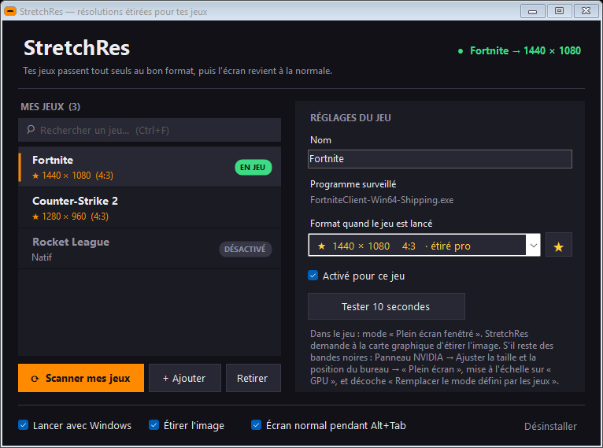

# StretchRes

**Résolution étirée automatique pour tes jeux, en un clic.**
StretchRes passe ton écran en résolution étirée (1440×1080, 1280×960…) dès qu'un jeu choisi se lance, puis remet la résolution native quand tu le quittes.

> *EN: Windows tray app that automatically switches to a stretched resolution when a chosen game starts and restores your native resolution when it closes. The UI is in French.*



## Fonctionnalités

- **Détection automatique** : surveille les jeux de ta liste et applique leur format au lancement, puis revient à la normale à la fermeture.
- **Étirement par la carte graphique** : garde le signal natif de l'écran et laisse le GPU étirer l'image (pas de bandes noires dans la plupart des cas).
- **Scanner mes jeux** : trouve tout seul les jeux installés (Steam, Epic, etc.) et les ajoute à la liste.
- **Écran normal pendant Alt+Tab** : le bureau reste en résolution native quand tu sors du jeu.
- **Résolutions favorites**, bouton **Tester 10 secondes**, lancement discret avec Windows (icône près de l'horloge).
- Léger : un seul `.exe` d'environ 75 Ko, sans dépendance à installer.

## Installation

1. Télécharge `StretchRes.exe` depuis la page [**Releases**](https://github.com/Bitashie/stretchres/releases/latest).
2. Lance-le. Il s'installe dans `%LOCALAPPDATA%\StretchRes`, se lance avec Windows et ouvre sa fenêtre.
3. Clique sur **Scanner mes jeux** ou **+ Ajouter**, puis choisis le format de chaque jeu.

Pour une mise à jour, lance simplement le nouveau `.exe` : il ferme l'ancienne version et la remplace.
Pour l'utiliser sans l'installer : `StretchRes.exe --portable`.

> Windows SmartScreen peut afficher un avertissement car l'exécutable n'est pas signé : **Informations complémentaires → Exécuter quand même**.

### Conseils

- Dans le jeu, choisis le mode **« Plein écran fenêtré »**.
- S'il reste des bandes noires (NVIDIA) : *Panneau de configuration NVIDIA → Ajuster la taille et la position du bureau* → « Plein écran », mise à l'échelle sur « GPU », et coche « Remplacer le mode défini par les jeux et les programmes ».
- En cas de souci, clic droit sur l'icône → **Remettre la résolution normale**.

## Compiler depuis les sources

Aucun Visual Studio nécessaire : le compilateur C# de .NET Framework 4 est déjà présent dans Windows.

```powershell
powershell -ExecutionPolicy Bypass -File build.ps1
```

L'exécutable est généré dans `bin\StretchRes.exe`.

Options en ligne de commande utiles pour le développement :

| Option | Effet |
| --- | --- |
| `--portable` | Lance sans s'installer ni s'ajouter au démarrage |
| `--selftest fichier.txt` | Écrit un diagnostic (écran, modes disponibles, jeux trouvés) sans rien modifier |
| `--snap image.png` | Capture la fenêtre avec des jeux d'exemple, sans rien enregistrer |

## Configuration

Les réglages sont stockés dans `%LOCALAPPDATA%\StretchRes\config.txt`. Le bouton **Désinstaller** de l'application retire le lancement au démarrage et supprime ce dossier.

## Licence

[MIT](LICENSE)
